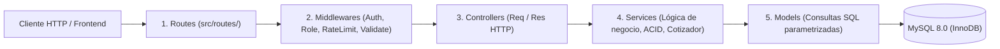

# Librería Estudio — Backend API

API REST de **Librería Estudio**, plataforma de comercio electrónico especializada en útiles escolares, papelería técnica y textos de estudio. Está construida sobre **Node.js 20**, **Express** y **MySQL 8.0** con una arquitectura modular de **5 capas**, cotizador inteligente de listas escolares, reservas atómicas de inventario y checkout transaccional ACID.

---

## Stack tecnológico

| Capa / Área | Tecnología | Propósito en el proyecto |
| :--- | :--- | :--- |
| **Runtime** | Node.js `>=20.0.0` | Ejecución del servidor HTTP, jobs periódicos y pruebas nativas (`node --test`). |
| **Framework HTTP** | Express `4.19.x` | Enrutamiento `/api/v1`, middlewares de seguridad, validación y manejo de errores. |
| **Base de datos** | MySQL `8.0` (`mysql2/promise`) | Almacenamiento relacional InnoDB (`utf8mb4`), transacciones ACID y `CHECK` constraints. |
| **Seguridad** | Helmet, CORS, `hpp`, `express-rate-limit`, JWT, `bcryptjs` | Hardening HTTP, control de orígenes, protección contra fuerza bruta y RBAC. |
| **Validación y Correo** | `express-validator`, `nodemailer` | Validación declarativa de entrada y envío de correos transaccionales (recuperación/soporte). |
| **Contenedores** | Docker & Docker Compose | Entorno reproducible con red interna aislada (`backend-internal-net`) y `healthcheck`. |
| **Calidad de código** | ESLint, Prettier | Linting estático, formato consistente y verificación de sintaxis (`npm run verificar`). |

---

## Arquitectura en 5 capas

El flujo de cada petición HTTP atraviesa cinco capas con responsabilidades estrictamente separadas. Ninguna ruta accede directamente a SQL y la lógica de negocio vive exclusivamente en los servicios:



| Capa | Carpeta | Responsabilidad principal |
| :--- | :--- | :--- |
| **1. Routes** | `src/routes/` | Mapeo de endpoints bajo `/api/v1`, encadenamiento de middlewares y validadores. |
| **2. Middlewares** | `src/middlewares/` | Autenticación JWT (`authMiddleware`), RBAC (`requireRole`), rate limiting, validación y errores. |
| **3. Controllers** | `src/controllers/` | Extracción de parámetros/headers (`X-Cart-Token`), invocación de servicios y respuesta uniforme. |
| **4. Services** | `src/services/` | Reglas de negocio, transacciones ACID, reservas de stock y algoritmo del cotizador. |
| **5. Models** | `src/models/` | Acceso exclusivo a MySQL 8 mediante consultas preparadas (`?`) y bloqueos `FOR UPDATE`. |

---

## Estructura real del repositorio

```text
libreria-estudio-backend/
├── .dockerignore                  # Exclusiones para la construcción de la imagen Docker
├── .env.example                   # Plantilla de variables de entorno (sin secretos reales)
├── .eslintrc.json                 # Configuración de reglas ESLint
├── .prettierrc.json               # Configuración de formato Prettier
├── Dockerfile                     # Imagen node:20-alpine ejecutándose como usuario no-root (appuser)
├── docker-compose.yml             # Orquestación de mysql-db + backend-api con redes aisladas
├── package.json                   # Dependencias y scripts (start, dev, migrate, seed, test, lint)
├── README.md                      # Documentación principal del backend
├── database/
│   ├── docker-init.sh             # Script de inicialización automática al crear el contenedor MySQL
│   ├── migrations/                # Migraciones SQL incrementales (001 a 006)
│   │   ├── 001_create_users_and_addresses.sql
│   │   ├── 002_create_catalog_and_attributes.sql
│   │   ├── 003_create_cart_and_reservations.sql
│   │   ├── 004_create_orders_and_items.sql
│   │   ├── 005_create_support_and_legal.sql
│   │   └── 006_create_indexes_and_constraints.sql
│   └── seeds/                     # Datos iniciales idempotentes (categorías, marcas, productos, FAQs)
│       ├── 001_seed_categories_and_brands.sql
│       ├── 002_seed_study_products.sql
│       └── 003_seed_faq_items.sql
├── docs/
│   ├── api-endpoints.md           # Contrato REST /api/v1 con ejemplos reales de JSON
│   ├── database-architecture.md   # Diagrama ER en Mermaid, transacciones ACID e índices
│   └── security-and-anti-block-checklist.md # Checklist de seguridad y operación
├── src/
│   ├── app.js                     # Configuración de Express, Helmet, CORS, HPP, Rate Limit y rutas
│   ├── server.js                  # Arranque HTTP, timeouts, job periódico y graceful shutdown
│   ├── config/                    # Carga y validación estricta de entorno, pool MySQL, mail y seguridad
│   ├── controllers/               # Controladores HTTP por dominio (auth, products, cart, orders, admin...)
│   ├── db/                        # Runners de migraciones (migrate.js), seeds (seed.js) y SQL (sqlRunner.js)
│   ├── jobs/                      # Job periódico releaseExpiredReservationsJob.js
│   ├── middlewares/               # auth, role, rateLimit, termsAcceptance, validate y errorMiddleware
│   ├── models/                    # Capa de acceso a datos MySQL por entidad
│   ├── routes/                    # Definición de rutas y montaje central en src/routes/index.js
│   ├── services/                  # Lógica de negocio (cotizador, inventario, pagos, órdenes, admin)
│   ├── utils/                     # AppError, constants, logger (con redacción), responseHelper y sanitizer
│   └── validators/                # Reglas express-validator por módulo
└── tests/
    └── unit.test.js               # Suite de 31 pruebas unitarias con node:test
```

---

## Cómo funciona la API REST (`/api/v1`)

Todas las rutas de negocio se montan en `src/routes/index.js` bajo el prefijo configurable `API_PREFIX` (por defecto `/api/v1`). Además, `GET /health` está expuesto en la raíz para compatibilidad con `HEALTHCHECK` de Docker.

### Formato estándar de respuestas (`src/utils/responseHelper.js`)

**Respuesta exitosa:**
```json
{
  "success": true,
  "message": "Operación exitosa",
  "data": {},
  "meta": {
    "page": 1,
    "limit": 20,
    "total": 45
  }
}
```
*(El campo `meta` es opcional y se incluye en listados paginados).*

**Respuesta de error:**
```json
{
  "success": false,
  "error": {
    "code": "VALIDATION_ERROR",
    "message": "Descripción legible del error",
    "details": []
  }
}
```
*(En producción, `errorMiddleware.js` oculta trazas internas y detalles SQL ante errores `500`).*

### Seguridad integrada

- **Helmet & HPP (`src/app.js`, `src/config/security.js`):** Cabeceras de seguridad HTTP, `x-powered-by` deshabilitado, límite de payload JSON/URL-encoded de `100kb` y protección contra HTTP Parameter Pollution.
- **CORS estricto:** Lista blanca configurable mediante `CORS_ORIGIN`. En `NODE_ENV=production`, `src/config/env.js` rechaza iniciar si `CORS_ORIGIN` es `*` o está vacío.
- **Rate Limiting (`src/middlewares/rateLimitMiddleware.js`):**
  - General (`/api/v1`): `100` peticiones / `15 min` (configurable con `RATE_LIMIT_WINDOW_MS` y `RATE_LIMIT_MAX`).
  - Autenticación (`authLimiter`): `15` intentos / `15 min`.
  - Búsqueda y cotizador (`searchQuoteLimiter`): `60` consultas / `15 min`.
  - Soporte (`supportLimiter`): `10` solicitudes / `15 min`.
- **Autenticación JWT y RBAC:** Tokens firmados con `JWT_SECRET` (mínimo 32 caracteres en producción), contraseñas hasheadas con `bcryptjs` (`BCRYPT_ROUNDS`, rango `10–14`, por defecto `12`) y middleware `requireRole('admin')` para todo `/api/v1/admin` y cambios de estado de órdenes.
- **Sanitización y Logs seguros:** `src/utils/sanitizer.js` limpia texto, normaliza correos y escapa comodines SQL `LIKE` (`%`, `_`, `\`). `src/utils/logger.js` redacta recursivamente campos sensibles (`password`, `token`, `authorization`).

### Cotizador de listas escolares (`POST /api/v1/school-lists/quote`)

Implementado en `src/services/schoolListService.js`:
1. Parsea líneas de texto libre (`rawText`) o arreglos estructurados (`items`), extrayendo cantidades iniciales o finales (ej. `2 cuadernos`, `Cuaderno A4 x2`).
2. Normaliza texto sin tildes y detecta atributos técnicos (`ruling_type`, `sheet_count`, `paper_weight_gsm`, `format_size`, `lead_grade`, `color_count`, `ink_color`, `tip_size_mm`, `education_level`).
3. Evalúa candidatos en catálogo por coincidencia de palabras clave y atributos, devolviendo cada ítem clasificado como `exact_match`, `alternative`, `out_of_stock` o `not_found`, junto con el subtotal estimado.

### Reservas atómicas y job periódico

- **Reserva atómica (`src/services/inventoryService.js` + `src/models/reservationModel.js`):** Al agregar productos o reservar el carrito (`POST /api/v1/cart/reserve`), se ejecuta una transacción ACID con actualización condicional `UPDATE products SET stock_available = stock_available - ?, stock_reserved = stock_reserved + ? WHERE id = ? AND is_active = 1 AND stock_available >= ?`, evitando sobreventa por concurrencia.
- **Job periódico (`src/jobs/releaseExpiredReservationsJob.js`):** Iniciado automáticamente en `src/server.js` al arrancar el servidor. Cada `RESERVATION_CLEANUP_INTERVAL_MS` (por defecto `60000 ms`) busca reservas `active` vencidas (`RESERVATION_TTL_MINUTES`, por defecto `20 min`) usando `SELECT ... FOR UPDATE` en lotes de hasta 100 registros, las marca como `expired` y devuelve el stock a `stock_available`.

---

## Base de Datos MySQL 8

El esquema utiliza el motor **InnoDB** con codificación `utf8mb4` / `utf8mb4_unicode_ci` y consta de **15 tablas de negocio** organizadas en **5 dominios** (más la tabla de control `schema_migrations`):

| Dominio | Migración | Tablas incluidas |
| :--- | :--- | :--- |
| **1. Usuarios y Direcciones** | `001_create_users_and_addresses.sql` | `users`, `password_reset_tokens`, `user_addresses` |
| **2. Catálogo y Atributos** | `002_create_catalog_and_attributes.sql` | `categories`, `brands`, `products`, `product_attributes` |
| **3. Carrito y Reservas** | `003_create_cart_and_reservations.sql` | `carts`, `cart_items`, `stock_reservations` |
| **4. Órdenes e Ítems** | `004_create_orders_and_items.sql` | `orders`, `order_items` |
| **5. Soporte y Legal** | `005_create_support_and_legal.sql` | `faq_items`, `support_tickets`, `cookie_consents` |
| **Índices y `CHECK`** | `006_create_indexes_and_constraints.sql` | Índices compuestos y restricciones `CHECK` de MySQL 8.0.16+ |

- **Migraciones (`npm run migrate` → `src/db/migrate.js`):** Ejecuta en orden los scripts `001`–`006` de `database/migrations/` de forma idempotente y registra cada archivo aplicado en `schema_migrations`.
- **Seeds (`npm run seed` → `src/db/seed.js`):** Carga `001_seed_categories_and_brands.sql`, `002_seed_study_products.sql` y `003_seed_faq_items.sql`.
- **Promoción de administrador (`BOOTSTRAP_ADMIN_EMAIL`):** Si se define `BOOTSTRAP_ADMIN_EMAIL` en el entorno al ejecutar `npm run seed`, el script promueve automáticamente al usuario existente con ese correo a `role = 'admin'` y `is_active = 1`.

> Para ver el diagrama Entidad-Relación (`erDiagram`) completo y los detalles de transacciones ACID, consulta [`docs/database-architecture.md`](docs/database-architecture.md).

---

## Guía de instalación y ejecución

### Opción A: Con Docker Compose (recomendada)

1. Copia la plantilla de variables de entorno y configura contraseñas seguras y `JWT_SECRET` (puedes generarlo con `openssl rand -hex 32`):
   ```bash
   cp .env.example .env
   ```
2. Construye y levanta los servicios `mysql-db` y `backend-api`:
   ```bash
   docker compose up -d --build
   ```
   El contenedor `backend-api` espera a que `mysql-db` pase su `healthcheck`, ejecuta automáticamente `npm run migrate && npm run seed` y arranca `node src/server.js` en el puerto configurado (`3000` por defecto).
3. Verifica el estado:
   ```bash
   docker compose ps
   curl http://localhost:3000/health
   ```

### Opción B: En desarrollo local (sin Docker para Node.js)

Requiere **Node.js >= 20** y una instancia accesible de **MySQL 8.0**.

1. Instala las dependencias:
   ```bash
   npm install
   ```
2. Configura `.env` (con `DB_HOST=127.0.0.1` y las credenciales de tu MySQL local):
   ```bash
   cp .env.example .env
   ```
3. Ejecuta migraciones y carga inicial de datos:
   ```bash
   npm run migrate
   npm run seed
   ```
4. Inicia el servidor en modo desarrollo con recarga automática:
   ```bash
   npm run dev
   ```

### Opción C: Producción en Railway

El backend se encuentra desplegado en Railway en la URL pública:
- **Base URL:** `https://libreria-estudio-backend-production.up.railway.app`
- **Healthcheck:** `https://libreria-estudio-backend-production.up.railway.app/health`
- **Prefijo API:** `https://libreria-estudio-backend-production.up.railway.app/api/v1`

En producción (`NODE_ENV=production`), `src/config/env.js` exige obligatoriamente `DB_HOST`, `DB_NAME`, `DB_USER`, `DB_PASSWORD`, `JWT_SECRET` (mínimo 32 caracteres, sin prefijo `CHANGE_ME`) y `CORS_ORIGIN` restringido a orígenes autorizados.

---

## Pruebas y verificación de código

El repositorio cuenta con **31 pruebas unitarias** distribuidas en **11 suites** dentro de `tests/unit.test.js` usando el corredor nativo `node:test` (sin dependencias externas ni necesidad de MySQL activo).

```bash
# Ejecutar las 31 pruebas unitarias
npm test

# Verificar sintaxis de todo src/ y ejecutar ESLint
npm run verificar
```

---

## Documentación adicional

- [`docs/api-endpoints.md`](docs/api-endpoints.md) — Referencia completa de endpoints `/api/v1` con ejemplos reales de petición y respuesta JSON.
- [`docs/database-architecture.md`](docs/database-architecture.md) — Diagrama ER (`erDiagram`), transacciones ACID, reservas atómicas, snapshots inmutables e índices.
- [`docs/security-and-anti-block-checklist.md`](docs/security-and-anti-block-checklist.md) — Checklist de seguridad, anti-IDOR, validación y operación.
