# Arquitectura de Base de Datos — Librería Estudio

El backend utiliza **MySQL 8.0** con el motor transaccional **InnoDB** y codificación `utf8mb4` / `utf8mb4_unicode_ci`. El esquema se compone de **15 tablas de negocio** distribuidas en **5 dominios**, además de la tabla de control `schema_migrations`.

---

## Diagrama Entidad-Relación (`erDiagram`)

```mermaid
erDiagram
    users ||--o{ password_reset_tokens : "tiene"
    users ||--o{ user_addresses : "guarda"
    users ||--o{ carts : "posee"
    users ||--o{ stock_reservations : "origina"
    users ||--o{ orders : "realiza"
    users ||--o{ support_tickets : "abre"
    users ||--o{ cookie_consents : "registra"

    categories ||--o{ categories : "subcategoria"
    categories ||--o{ products : "agrupa"
    brands ||--o{ products : "fabrica"
    products ||--o{ product_attributes : "detalla"

    carts ||--o{ cart_items : "contiene"
    products ||--o{ cart_items : "referenciado_en"
    carts ||--o{ stock_reservations : "bloquea"
    products ||--o{ stock_reservations : "reserva"

    orders ||--o{ order_items : "incluye"
    products ||--o{ order_items : "snapshot_de"

    users {
        bigint id PK
        varchar full_name
        varchar email UK
        varchar password_hash
        enum role "customer | admin"
        tinyint is_active
    }

    password_reset_tokens {
        bigint id PK
        bigint user_id FK
        char token_hash UK
        datetime expires_at
        datetime used_at
    }

    user_addresses {
        bigint id PK
        bigint user_id FK
        varchar label
        varchar city
        varchar state_or_department
        tinyint is_default
    }

    categories {
        bigint id PK
        bigint parent_id FK
        varchar name
        varchar slug UK
        tinyint is_active
    }

    brands {
        bigint id PK
        varchar name
        varchar slug UK
        tinyint is_active
    }

    products {
        bigint id PK
        bigint category_id FK
        bigint brand_id FK
        varchar sku UK
        varchar title
        varchar slug UK
        decimal price
        int stock_available
        int stock_reserved
        tinyint is_active
    }

    product_attributes {
        bigint id PK
        bigint product_id FK
        varchar attribute_key
        varchar attribute_value
        varchar display_label
    }

    carts {
        bigint id PK
        bigint user_id FK
        char session_token_hash
        datetime expires_at
    }

    cart_items {
        bigint id PK
        bigint cart_id FK
        bigint product_id FK
        int quantity
    }

    stock_reservations {
        bigint id PK
        bigint cart_id FK
        bigint user_id FK
        bigint product_id FK
        int quantity
        enum status "active | completed | expired | released"
        datetime expires_at
    }

    orders {
        bigint id PK
        varchar order_number UK
        bigint user_id FK
        varchar customer_email
        json shipping_address_snapshot
        enum delivery_method "home_delivery | store_pickup"
        decimal total_amount
        enum status
        varchar payment_reference UK
        tinyint terms_accepted
    }

    order_items {
        bigint id PK
        bigint order_id FK
        bigint product_id FK
        varchar sku_snapshot
        varchar title_snapshot
        decimal unit_price_snapshot
        int quantity
        decimal line_total
    }

    faq_items {
        bigint id PK
        varchar topic
        varchar question
        text answer
        int sort_order
        tinyint is_active
    }

    support_tickets {
        bigint id PK
        varchar ticket_code UK
        bigint user_id FK
        varchar contact_email
        varchar order_number
        enum status "open | in_progress | resolved | closed"
    }

    cookie_consents {
        bigint id PK
        bigint user_id FK
        char consent_token_hash
        tinyint necessary_enabled
        tinyint analytics_enabled
        tinyint preferences_enabled
    }
```



---

## Transacciones ACID y Bloqueo Atómico de Stock

La integridad del inventario frente a peticiones concurrentes se garantiza combinando transacciones InnoDB (`conn.beginTransaction()` / `commit()` / `rollback()`) con actualizaciones condicionales y bloqueos de fila.

### 1. Reserva atómica de inventario (`src/models/reservationModel.js`)

Al agregar ítems al carrito o iniciar el checkout (`POST /api/v1/cart/reserve`), no se lee el stock en memoria para luego restarlo; en su lugar, se ejecuta una única sentencia SQL atómica dentro de la transacción:

```sql
UPDATE products
SET stock_available = stock_available - ?,
    stock_reserved = stock_reserved + ?
WHERE id = ?
  AND is_active = 1
  AND stock_available >= ?
```

- Si `affectedRows === 0`, el servicio (`src/services/inventoryService.js`) lanza `409 Conflict` (`INSUFFICIENT_STOCK`) y revierte la transacción completa.
- De forma complementaria, la migración `006` impone `CHECK (stock_available >= 0)` y `CHECK (stock_reserved >= 0)` directamente en el motor MySQL 8.

### 2. Liberación segura de reservas expiradas (`FOR UPDATE`)

El job periódico `src/jobs/releaseExpiredReservationsJob.js` ejecuta `inventoryService.releaseExpiredReservationsBatch(100)` dentro de una transacción ACID:

1. Selecciona reservas vencidas bloqueando sus filas para evitar doble liberación entre procesos:
   ```sql
   SELECT id, cart_id, user_id, product_id, quantity, expires_at
   FROM stock_reservations
   WHERE status = 'active' AND expires_at <= UTC_TIMESTAMP()
   ORDER BY expires_at ASC
   LIMIT ?
   FOR UPDATE
   ```
2. Transiciona el estado de `'active'` a `'expired'` y restaura `stock_available` desde `stock_reserved`.

### 3. Checkout transaccional e idempotencia (`src/services/orderService.js`)

Al crear una orden (`POST /api/v1/orders`):
- Si el cliente envía `paymentReference` y ya existe una orden asociada (`uq_orders_payment_reference`), se devuelve la orden existente sin duplicar cargos ni descontar inventario dos veces (`idempotentReplay: true`).
- Dentro de la transacción se completan las reservas activas del carrito (`status = 'completed'`, reduciendo `stock_reserved`), se reconcilia cualquier delta no reservado, se recalculan precios/totales en el servidor y se vacía el carrito al confirmar con `commit()`.

---

## Snapshots Inmutables en `orders` y `order_items`

En un e-commerce, los precios, títulos, SKU o direcciones de un usuario pueden cambiar después de realizada una compra. Para preservar la integridad histórica y contable:

- **`orders.shipping_address_snapshot` (`JSON`):** Almacena una copia exacta de la dirección de entrega vigente al momento del checkout, independiente de futuras ediciones o eliminaciones en `user_addresses`.
- **`order_items`:** Registra `sku_snapshot`, `title_snapshot`, `unit_price_snapshot` y `line_total` al crear la orden. Además, la clave foránea `fk_order_items_product` usa `ON DELETE RESTRICT` para impedir la eliminación física de productos con historial de ventas.

---

## Índices y Restricciones de Integridad (`006_create_indexes_and_constraints.sql`)

La migración `006` optimiza las consultas frecuentes y refuerza reglas de negocio a nivel de base de datos (MySQL `8.0.16+`):

| Tabla | Índices añadidos (`006`) | Restricciones `CHECK` |
| :--- | :--- | :--- |
| **`products`** | `(category_id, is_active)`, `(brand_id, is_active)`, `(is_active, price)` | `units_per_pack >= 1`, `price >= 0.00`, `stock_available >= 0`, `stock_reserved >= 0` |
| **`product_attributes`** | `(attribute_key, attribute_value)` | — |
| **`carts`** | `(session_token_hash)`, `(expires_at)` | — |
| **`cart_items`** | — | `quantity > 0` |
| **`stock_reservations`** | `(status, expires_at)`, `(cart_id, status)` | `quantity > 0` |
| **`orders`** | `(user_id, created_at)`, `(order_number, customer_email)`, `(status, created_at)` | `subtotal`, `discount_amount`, `shipping_cost`, `tax_amount`, `total_amount >= 0.00` |
| **`order_items`** | — | `quantity > 0`, `unit_price_snapshot >= 0.00`, `line_total >= 0.00` |
| **`support_tickets`** | `(user_id, status)`, `(ticket_code, contact_email)` | — |
| **`faq_items`** | `(topic, is_active, sort_order)` | — |
| **`cookie_consents`** | `(consent_token_hash)` | — |

---

## Control de Migraciones (`schema_migrations`)

El runner `src/db/migrate.js` crea y consulta la tabla `schema_migrations` antes de ejecutar los archivos de `database/migrations/`:

```sql
CREATE TABLE IF NOT EXISTS schema_migrations (
  id BIGINT UNSIGNED NOT NULL AUTO_INCREMENT,
  filename VARCHAR(255) NOT NULL,
  applied_at DATETIME NOT NULL DEFAULT CURRENT_TIMESTAMP,
  PRIMARY KEY (id),
  UNIQUE KEY uq_schema_migrations_filename (filename)
) ENGINE=InnoDB DEFAULT CHARSET=utf8mb4 COLLATE=utf8mb4_unicode_ci;
```

- Cada archivo `.sql` se divide en sentencias individuales (`splitSqlStatements`) y se ejecuta solo si su `filename` no existe en `schema_migrations`.
- Los códigos de error idempotentes definidos en `src/db/sqlRunner.js` (como tabla o índice ya existente) se omiten de forma segura para tolerar re-ejecuciones parciales.
- Al finalizar cada archivo, se registra su nombre con `INSERT IGNORE INTO schema_migrations (filename) VALUES (?)`.
